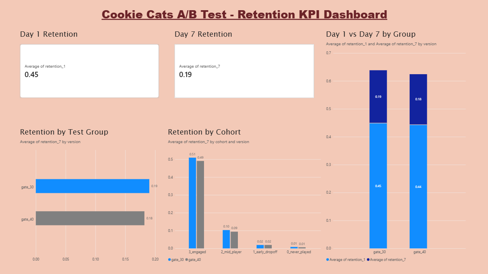

# Cookie Cats A/B Test — Retention KPI Analysis

## Overview
A/B test analysis on 90,189 mobile game players to evaluate whether moving a game gate from level 30 to level 40 impacts player retention.

## Business Question
Does moving the gate from level 30 to level 40 improve or hurt Day 7 player retention?

## Tools Used
- **MySQL** — data storage and cohort segmentation
- **Python (pandas, statsmodels)** — statistical z-test
- **Power BI** — KPI dashboard

## Dataset
- Source: [Cookie Cats — Kaggle](https://www.kaggle.com/datasets/yufengsui/mobile-games-ab-testing)
- 90,189 players split into two groups:
  - `gate_30` (control) — gate at level 30
  - `gate_40` (treatment) — gate at level 40

## Key Results

| Metric | gate_30 (control) | gate_40 (treatment) |
|--------|-------------------|----------------------|
| Total users | 44,700 | 45,489 |
| Day 1 Retention | 44.82% | 44.23% |
| Day 7 Retention | 19.02% | 18.20% |
| Relative lift | +4.5% (gate_30 wins) | baseline |
| Z-statistic | 3.16 | — |
| P-value | 0.0016 | — |
| Significant? | ✅ Yes | — |

## Conclusion
Gate at level 30 produces statistically significantly better Day 7 retention (p = 0.0016). Recommendation: do not move the gate to level 40.

The effect is strongest among highly engaged players (40+ rounds): 50.93% vs 49.09% Day 7 retention — suggesting the earlier gate creates a natural engagement hook.

## SQL Analysis
Three queries were written in MySQL:
1. Core group comparison — retention rates per group
2. Funnel drop-off — players by engagement level
3. Cohort retention — Day 7 retention broken down by engagement cohort

## Python Z-Test
Two-proportion z-test using `statsmodels.stats.proportion.proportions_ztest`
- Z-statistic: 3.1644
- P-value: 0.0016
- Result: Statistically significant at p < 0.05

## Power BI Dashboard

KPIs tracked:
- Day 1 and Day 7 retention rates
- Retention by test group
- Retention by cohort (engagement level)
- Day 1 vs Day 7 side by side comparison

## Files
| File | Description |
|------|-------------|
| `cookie_cats.csv` | Raw dataset |
| `ab_test_analysis.py` | Python z-test script |
| `powerbi_data.csv` | Cleaned export for Power BI |
| `dashboard_screenshot.png` | Power BI dashboard screenshot |
